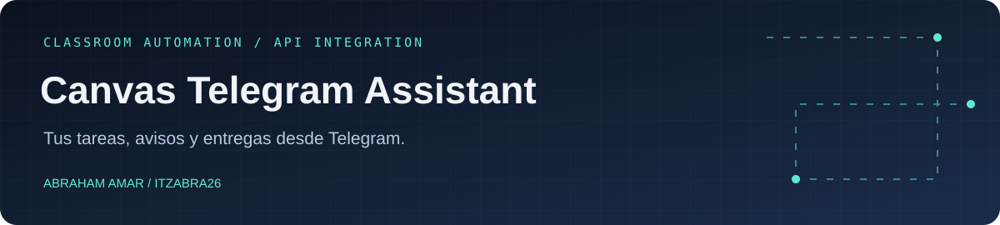
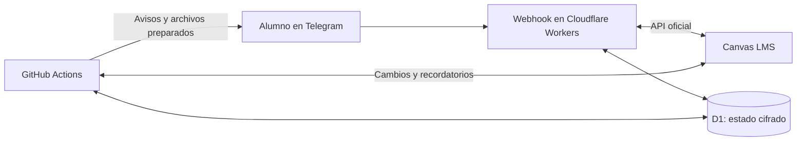

<p align="center"></p>

<p align="center">
  <a href="https://github.com/ItzAbra26/canvas-telegram-assistant/actions/workflows/tests.yml"></a>
  
  
  
</p>

## Menos tiempo buscando tareas. Más tiempo para hacerlas.

Asistente de **Canvas LMS conectado a Telegram**, creado para una práctica de clase de **15 alumnos**. Cada alumno consulta sus asignaturas y vencimientos en privado, recibe recordatorios y puede preparar una entrega sin salir del chat.

**[Guía de uso y despliegue](docs/GUIA.md)** · **[Seguridad](SECURITY.md)** · **[Verificación](docs/VERIFICACION.md)** · **[Código del webhook](cloud/handler.mjs)**

## Qué resuelve

| Necesidad | Solución |
| --- | --- |
| Saber qué entregar primero | Resumen de pendientes, vencidas y próximas entregas |
| Enterarse de un cambio | Avisos de tareas nuevas y cambios de fecha o contenido |
| Recordar un plazo | Recordatorios a 7 días, 3 días, 24 horas y 3 horas |
| Entregar varios documentos | Selección de tarea y hasta 8 archivos con confirmación final |
| Reducir el peso de un trabajo | Preparación de PDF y ZIP, conservando el original si no mejora |
| Mantener los datos separados | Estado cifrado y consultas asociadas a cada alumno |

### Un recorrido por el bot

```text
/resumen    → Qué queda pendiente y cuál es la próxima entrega
/semana     → Fechas de los próximos siete días
/actualizar → Consultar Canvas de nuevo
/entregar   → Elegir tarea → añadir documentos → revisar → confirmar
```

**Enviar un documento no registra una entrega.** El paso final exige pulsar **Entregar ahora**; el bot comprueba después la respuesta de Canvas. Las tareas SCORM están excluidas de las consultas y del selector.

## Cómo funciona



El webhook responde a los comandos con el estado guardado; **GitHub Actions revisa Canvas cada hora** y prepara documentos en otra tarea programada. La actualización manual permite consultar de nuevo sin esperar a la revisión horaria.

| Capa | Tecnología y responsabilidad |
| --- | --- |
| Sincronización | Python: consulta, comparación, recordatorios y persistencia |
| Interacción | JavaScript en Workers: botones, registro y entregas confirmadas |
| Datos | D1 con contenido cifrado y escrituras con control de versión |
| Documentos | pikepdf y ZIP: preparación en un subproceso con límites |
| Automatización | GitHub Actions y APIs oficiales de Telegram y Canvas |

## Pruébalo sin credenciales

```bash
python -m venv .venv
# Activa el entorno virtual en tu sistema antes del siguiente paso.
python -m pip install -r requirements-dev.txt
python -m src.main --demo
python -m pytest
```

Para el webhook, con **Node.js 24**:

```bash
npm ci --prefix cloud
npm test --prefix cloud
npm run check --prefix cloud
```

La demo utiliza cuentas sintéticas y no contacta con alumnos ni modifica Canvas. En Windows, activa el entorno con `.venv\Scripts\Activate.ps1`; en Linux/macOS, con `source .venv/bin/activate`.

## Uso en clase y seguridad

La instalación de clase se abre en **[SuperDelegado2B en Telegram](https://t.me/SuperDelegado2B_bot)**. El acceso debe limitarse mediante una **lista de alumnos o un código de invitación**. Esta revisión cierra las altas nuevas si no hay ninguno configurado; las cuentas existentes se conservan.

El proyecto incluye validación del secreto del webhook, cifrado autenticado del estado, separación por alumno y comprobaciones antes de las entregas. El historial público también puede contener copias cifradas antiguas: no publiques nunca la clave que las descifra.

**Alcance:** práctica docente con tokens manuales. Canvas exige **OAuth para aplicaciones multiusuario**; esta versión no implementa ese flujo. Las comprobaciones y el cifrado no convierten este prototipo en un servicio certificado para producción. [Referencia oficial de Canvas](https://developerdocs.instructure.com/services/canvas/oauth2/file.oauth).

Consulta [SECURITY.md](SECURITY.md) para conocer las medidas, los límites y cómo comunicar una incidencia. La [guía completa](docs/GUIA.md) conserva los comandos, instalación, cuotas, privacidad y solución de problemas.

## Qué demuestra este proyecto

- Integración de dos APIs con respuestas y errores controlados.
- Coordinación entre webhook y tareas programadas sin sobrescribir cambios simultáneos.
- Persistencia cifrada y separación de información por usuario.
- Diseño de interacciones que requieren confirmación para operaciones importantes.
- Pruebas de lógica, integraciones simuladas y compatibilidad entre Python y JavaScript.

---

**Abraham Amar Bentolila** · [GitHub](https://github.com/ItzAbra26) · [LinkedIn](https://www.linkedin.com/in/abraham-amar-bentolila-61bb75277/) · [Contacto](mailto:abrahamamar26@gmail.com)
